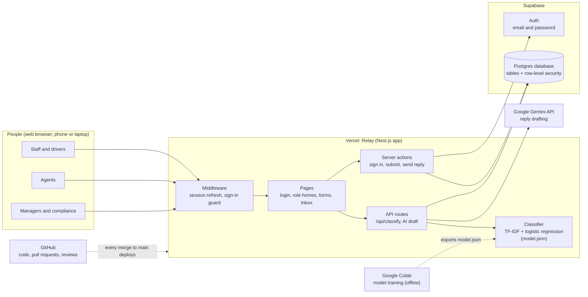
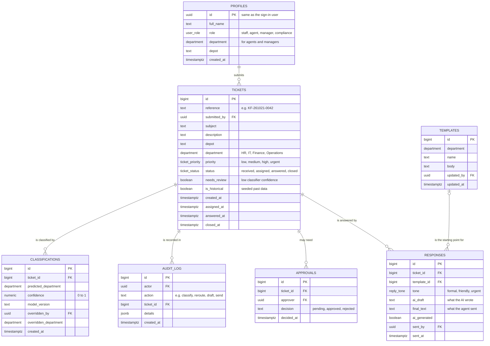
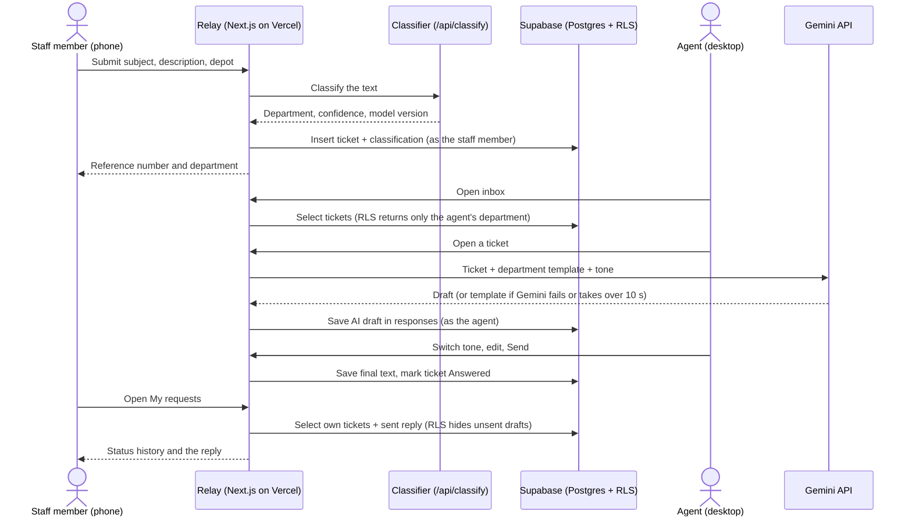

# Relay architecture

**Owner:** Samukelo · **Stories:** S1-20 (sections 1–4), S1-24 (sections 5–7) · **Last updated:** 22 Oct 2026

This document explains how Relay is built: its parts, why each was chosen, and how the data is organised. It is written for assessors, new team members and the Week 8 panel. You shouldn't need to read the code to follow it.

---

## 1. Overview

**Relay** is an AI-powered internal help desk for **Kopano Freight**, a fictional Johannesburg logistics company with about 350 staff across a head office, two depots and a driver workforce.

Staff submit a request (for example, *"My payslip is missing overtime"*). Relay then:

1. **Classifies** it to the right department (HR, IT, Finance or Operations) with a machine-learning model.
2. **Drafts a reply** with generative AI, in the tone the agent chooses (formal, friendly or urgent).
3. Lets an **agent** in that department edit the draft and send it.
4. Shows the staff member their request's **status** and the reply, in one place.

Later sprints add analytics and reports (Sprint 2), workload forecasting and AI risk and compliance (Sprint 3), and workflow automation with approvals (Sprint 4). The design in this document already makes room for them (see section 6).

**Users and roles**

| Role | Who at Kopano Freight | What they do in Relay |
| --- | --- | --- |
| Staff | Office staff, depot workers, drivers | Submit requests, track them, read replies |
| Agent | HR, IT, Finance and Operations team members | Work their department's inbox, edit and send AI-drafted replies |
| Manager | Department heads | Add users and set their roles, dashboards, reports, approvals (later sprints) |
| Compliance | Compliance officer | Audit log and AI risk reports (Sprint 3) |

---

## 2. Architecture diagram

Relay is one **Next.js** application hosted on **Vercel**, with **Supabase** for the database and sign-in, and **Google Gemini** for drafting replies. The classifier is trained offline in **Google Colab** and shipped inside the app as a JSON file.

**Reading the diagram:**
- Everyone uses the **same web app** in a browser. What they see depends on their role.
- The **middleware** runs before every page. It keeps the user signed in and sends anyone who isn't signed in to the login page.
- **Server actions and API routes** run on Vercel's servers, never in the browser. That's where secret keys live and where the app talks to Supabase and Gemini.
- **Supabase** checks every database request against **row-level security** rules, so each person only ever receives the rows they're allowed to see.
- The **classifier** is trained once in Colab, exported as `model.json`, and runs inside the app. There's no separate Python server.
- **GitHub** holds the code. Every merge into `main` redeploys the live site automatically, and every pull request gets its own preview link for review.

---

## 3. Components and technology choices

| Component | What it does in Relay | Why we chose it | Trade-off we accepted |
| --- | --- | --- | --- |
| **Next.js 15** (App Router, TypeScript, React 19) | The whole app: pages, forms, server actions and API routes | One codebase for the screens *and* the server code, so there's no separate backend to build and host. Server-side code keeps API keys out of the browser. TypeScript catches mistakes before they reach users. | Steeper learning curve than a simple tool like Streamlit. Worth it for a product that looks and behaves like a real internal system. |
| **Vercel** | Hosting, with automatic deploys | Made by the team behind Next.js, so it works with no configuration. Every merge to `main` goes live, and every pull request gets a **preview link** that reviewers use to test stories. Free for our size. | Free-tier limits on build time and function runtime; fine for a bootcamp-scale app. |
| **Supabase: Postgres** | Stores profiles, tickets, classifications, replies, templates, the audit log and approvals | A **relational** database suits our data: tickets *belong to* a department, replies *belong to* a ticket. Plain SQL also makes the Sprint 2 dashboards and Sprint 3 forecasts easy to query. | We manage schema changes ourselves, as numbered migration files. |
| **Supabase: Auth** | Email and password sign-in, sessions | Built in, secure, and connected to the database: the signed-in user's ID is available inside every database rule. | Email and password only for now. Single sign-on could be added later. |
| **Supabase: row-level security (RLS)** | Decides who can read or change each row | Permissions are enforced **inside the database**, so even a bug in a page can't leak another person's tickets. Staff see only their own requests, and agents only their department's. | Rules must be written and tested carefully. A missing rule silently returns no rows. |
| **Classifier: TF-IDF + logistic regression** (scikit-learn in Colab, exported to JSON, run in TypeScript) | Routes each request to HR, IT, Finance or Operations, with a confidence score | **Fast** (well under a second), **free** to run (no cost per ticket), **consistent** (the same text always gets the same answer) and **explainable** (we can show which words drove a decision, which matters for the Sprint 3 risk review). Trained on our own dataset: real IT tickets from Kaggle plus synthetic HR, Finance and Operations tickets. | Less flexible with unusual wording than a large language model. Low-confidence results (below 0.6) are flagged **"Needs review"** for a person to check. |
| **Google Gemini API** | Drafts replies from the ticket and its department's template, in the chosen tone | Strong writing quality, tone control through the prompt, and a free tier. Drafting is where generative AI adds most value: it saves agents time on every reply. | Depends on an outside service. If Gemini fails or takes over 10 seconds, the department template is used as the draft instead. Every draft is labelled "AI-drafted" and checked by an agent before sending. |
| **Tailwind CSS** (with shadcn/ui from S1-12) | Styling and a shared set of components | Consistent look across every screen, fast to build with, and accessible components out of the box. | Long class lists in the code, which take some getting used to. |
| **GitHub** | Code, pull requests, reviews | Every change is reviewed by a teammate before it reaches `main`, and the protection rule on `main` can't be bypassed, even by admins. | Every change needs a reviewer, so reviews must happen quickly. |
| **Google Colab** | Training and testing the classifier | Free, runs in the browser, and needs no installation on our laptops. | Training is a manual step: the exported model is committed to the repo. |

**Why not use Gemini for classification too?** We considered it. A trained classifier is cheaper (no cost per request), faster, gives the same answer every time, and can explain its decisions. Those qualities matter for routing, where consistency and auditability count more than eloquence. Gemini is used where language quality matters most: writing replies.

---

## 4. Data model

The database has **seven tables**. Every table has row-level security switched on.

**Reading the diagram:** every ticket is at the centre. One staff profile submits many tickets, and each ticket can have many classifications, audit entries, approvals and replies. A reply may start from one template. Lines show links between tables, not data flowing back and forth.

**Links to people** (left off the diagram so the lines stay clear): several tables record *who* did something, by pointing to `profiles`:

| Column | Means |
| --- | --- |
| `tickets.submitted_by` | the staff member who asked |
| `classifications.overridden_by` | the agent or manager who changed the AI's department |
| `responses.sent_by` | the agent who sent the reply |
| `templates.updated_by` | who last edited the template |
| `audit_log.actor` | who did the action |
| `approvals.approver` | the manager who decided |

**What each table holds**

| Table | Holds | Used from |
| --- | --- | --- |
| `profiles` | One row per user: name, role, department, depot. Created automatically when an account is added, with the role *staff*. Relay has no public sign-up: accounts are added for people. | Sprint 1 |
| `tickets` | Every request, with its department, priority, status and four timestamps | Sprint 1 |
| `classifications` | Every routing decision the AI made: department, confidence, model version, and any human override | Sprint 1 |
| `templates` | Approved reply wording for each department, which the AI builds on | Sprint 1 |
| `responses` | The AI's draft **and** the final text the agent sent, the tone, and who sent it when | Sprint 1 |
| `audit_log` | An append-only record of important actions (for example classify, reroute, draft, send) | Sprint 1 (re-routing); Sprint 3 (full audit) |
| `approvals` | Manager sign-offs for requests that need them | Sprint 4 |

**Design decisions in the data model**

- **Four timestamps on every ticket** (`created_at`, `assigned_at`, `answered_at`, `closed_at`). They let the Sprint 2 dashboard measure response times, and give the Sprint 3 forecast the history it needs, without changing the table later.
- **Classifications are kept, never overwritten.** When an agent re-routes a ticket, the AI's original decision stays alongside the override. That shows how often the AI was right, which feeds the Sprint 3 risk report.
- **Replies store both the AI draft and the final text.** We can show exactly what the AI suggested and what a person changed. This is a core part of using AI responsibly.
- **Historical tickets are marked** with `is_historical`, so a year of seeded past requests can feed the dashboards and forecasts without mixing with live work.
- **Fixed lists are database types** (`user_role`, `department`, `ticket_status`, `ticket_priority`, `reply_tone`), so the database itself rejects a misspelt department or status.
- **Every change to the structure is a numbered migration** in `supabase/migrations/` (`0001` to `0004` so far), reviewed in a pull request like any other code. Anyone can rebuild the database by running them in order.

| Migration | What it adds |
| --- | --- |
| `0001_initial_schema.sql` | All seven tables and the fixed-list types; row-level security switched on everywhere |
| `0002_profiles_on_signup.sql` | A profile is created automatically for each new user; users can read their own profile |
| `0003_tickets_privacy.sql` | Who can read and create tickets, plus helper functions for a user's role and department |
| `0004_team_policies.sql` | Rules for ticket updates, classifications, templates, replies and the audit log, plus the `reroute_ticket` function |

---

## 5. Request flow (submit to reply)

One request travels through Relay in eight steps, from a driver's phone to the reply on that phone. Every database read and write runs as the signed-in person, so the row-level security rules in section 7 apply at each step.

| Step | What happens | Where in the code | Data written | Story | Status (28 Oct) |
| --- | --- | --- | --- | --- | --- |
| 1 | A staff member signs in and fills in subject, description and depot on the phone form | `src/app/login/`, staff submit page | (none) | S1-09, S1-22 | Sign-in built; form in progress |
| 2 | The text is classified into HR, IT, Finance or Operations, with a confidence score | `src/app/api/classify/route.ts` | (none) | S1-21 | Keyword stub (`stub-0`) live; trained model in progress |
| 3 | The ticket and its classification are saved, and confidence below 0.6 sets `needs_review` | Submit server action | `tickets`, `classifications` | S1-22, S1-25 | In progress |
| 4 | The staff member sees the reference number and the department | Submit page | (none) | S1-22 | In progress |
| 5 | An agent opens the inbox: only their department, most urgent first then oldest, with a status filter and "Needs review" marked | `src/app/agent/page.tsx` | (none) | S1-19 | Built |
| 6 | Opening a ticket asks Gemini for a draft from the department template; if Gemini fails or takes over 10 seconds, the template is used | `src/app/agent/[id]/`, `src/app/api/generate-draft/route.ts` | `responses` (`ai_draft`, `tone`, `ai_generated`) | S1-08, S1-13 | Built |
| 7 | The agent switches tone (a new draft each time), edits the text and sends it | `src/app/agent/[id]/TicketReply.tsx`, `actions.ts` | `responses` (`final_text`, `sent_by`, `sent_at`); `tickets` (`status = answered`, `answered_at`) | S1-14, S1-23 | Built |
| 8 | The staff member opens My requests and sees the status history and the reply | Staff My requests and detail pages | (none) | S1-26, S1-28 | In progress |

**Moving a ticket to the right department:** if the agent decides a ticket belongs elsewhere, `reroute_ticket()` moves it, clears `needs_review`, records the override on the classification and writes an audit entry in one step (S1-25; the database function is built, the button is in progress).

## 6. How the design supports Sprints 2–4

Sprint 1 was built so that later sprints add to it rather than rebuild it. Most of what Sprints 2–4 need is already in the database; the rest is new screens, a few new columns and tables, and scheduled jobs.

**Already in place from Sprint 1**

- **Timestamps on every ticket** (`created_at`, `assigned_at`, `answered_at`, `closed_at`): the dashboard's response and resolution times, and the forecast's history.
- **A year of seeded past tickets** (`is_historical`): enough history for trends and forecasting from the first day of Sprint 2.
- **Every AI decision kept** (`classifications`, with confidence, model version and any override) and **both the AI draft and the sent reply** (`responses`): the evidence the Sprint 3 risk report needs.
- **An append-only `audit_log`** and an **`approvals` table**, already created and waiting for Sprints 3 and 4.
- **Manager and compliance roles** in the database, with row-level security that already lets them read every ticket.
- **One way to change the database:** a new numbered migration, reviewed in a pull request.

**What each sprint adds**

| Sprint | Feature | Builds on | What we add |
| --- | --- | --- | --- |
| 2 | Sprint 1 carry-over | `profiles`, roles, ticket timestamps | Manage users screen (managers add users and set roles; Supabase invite emails; public sign-up off) · `tickets.assigned_to` for "Assign to me" · ticket closing · priority chosen on submit · manager and compliance menus |
| 2 | Analytics dashboard | Ticket timestamps, departments, depots, seeded history | Metrics calculated in code; Gemini writes the weekly insight from those numbers |
| 2 | Automated reports | The same metrics | New `reports` table · a weekly job on a schedule (Vercel Cron) · PDF download per department |
| 3 | Workload forecast | Seeded history plus live tickets | Forecast by department, checked against the last 8 weeks (backtest) |
| 3 | AI risk and compliance | `classifications`, `responses`, `audit_log` | Flags on responses · audit entries for classify, draft and send · `/api/classify` behind sign-in or a rate limit · bias test |
| 4 | Workflow automation | `approvals`, roles, `reroute_ticket()` pattern | Request type and amount on tickets · approval rules and their row-level security · automatic assignment and escalation · email notifications (e.g. Resend) |
| 4 | Deployment and showcase | Vercel auto-deploy, seed script | Demo reset script · final accessibility and security checks |

**Why the stack can grow this way:** Postgres handles the reporting and forecasting queries with plain SQL, and Vercel runs scheduled jobs without a separate server. Row-level security means each new screen is protected by the database, not only by the page.

## 7. Security, roles and responsible AI

Relay holds staff requests that can be personal (payslips, leave, medical aid), so access is decided by the database, not just by what a page shows.

### 7.1 Roles: who can access what

| Role | Pages | Tickets | Replies | Templates | Audit log |
| --- | --- | --- | --- | --- | --- |
| Staff | Staff pages only | Their own; can submit | Only once sent (never an unsent AI draft) | No access | No access |
| Agent | Agent pages only | Their department's; can update them while they stay in it; can re-route | Create, edit and send on their department's tickets | Read all; edit their own department's | No access |
| Manager | Manager pages only | All; can update any | Create, edit and send on any ticket | Read and edit all | Read |
| Compliance | Compliance pages only | All (read only) | Read all | Read all | Read |

Anyone signed in can add an audit entry, but only in their own name, and nobody can edit or delete one.

### 7.2 How access is enforced

1. **Sign-in:** email and password through Supabase Auth. A wrong email or password gets one generic message, so the form doesn't reveal which accounts exist.
2. **No public sign-up:** accounts are added for people (Supabase dashboard for now; Manage users screen in Sprint 2). Every new account starts as *staff*.
3. **Middleware** runs before every page. It refreshes the session and sends anyone signed out to the login page. Only `/`, `/login` and `/api` are open.
4. **Role check on each page:** `requireRole()` sends a user who opens another role's page back to their own home.
5. **Row-level security on every table** (migrations 0001–0004): Postgres itself filters every query by the signed-in user's id and role. A bug in a page still can't show another person's tickets.
6. **Re-routing goes through one checked function,** `reroute_ticket()`. It confirms the caller is an agent of the ticket's current department or a manager, moves the ticket, records the override and writes an audit entry in one step.

### 7.3 Keys and secrets

| Key | Where it lives | Why |
| --- | --- | --- |
| Supabase URL and publishable (anon) key | Browser and server | Public by design; row-level security protects the data |
| Supabase secret (service-role) key | Only on a developer's laptop, for the one-off seed script | It bypasses row-level security, so it never goes in app code or on Vercel's public side |
| Gemini API key | Server only (`.env.local` and Vercel settings) | Never has the `NEXT_PUBLIC_` prefix, so it never reaches the browser |

No key or password is committed to GitHub. `.env` files are in `.gitignore` (only `.env.example`, with empty values, is committed), and test-account passwords are shared privately.

### 7.4 Responsible AI

| Rule | Why | Delivered by | Status (28 Oct) |
| --- | --- | --- | --- |
| Every AI draft is labelled "AI-drafted" | People know when they're reading machine-written text | S1-23 | Built |
| An agent reads and can edit every draft before it's sent; nothing is sent automatically | A person stays responsible for every reply | S1-23 | Built |
| Both the AI draft and the final text are stored | We can see what the AI suggested and what a person changed | S1-13, S1-23 | Built |
| The chosen tone is saved with the reply | Tone choices can be reviewed later | S1-14 | Built |
| If Gemini fails or takes over 10 seconds, the department template is used instead | Agents can always reply | S1-08, S1-13 | Built |
| Classifications below 0.6 confidence are marked "Needs review" | Uncertain routing goes to a person | S1-25 | In progress |
| An agent can correct the department; the AI's original choice is kept alongside | Shows how often the AI was wrong | S1-25 (`reroute_ticket()`) | Database function built; button in progress |
| Every classification records the model version | Results can be traced to the model that made them | S1-21 | In progress |
| Classifier accuracy is reported separately on real and synthetic tickets | Synthetic data can make a model look better than it is | S1-16 | In progress |
| Staff never see an unsent AI draft | Only what a person approved reaches staff | Migration 0004 | Built |

**Known limits, handled in Sprint 3:** we haven't yet tested drafts for bias across names, depots or roles; only re-routing writes to the audit log so far; `/api/classify` is open without sign-in; and there's no written POPIA note yet. Sprint 3 (AI Risk and Compliance) covers all four.
