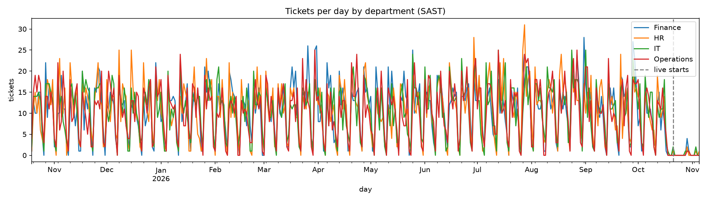

## Accuracy backtest (S2-17)

Origin: 8 Oct 2026, four weeks before the last history date (5 Nov 2026). The forecast is made from history up to 8 Oct and scored on 9 Oct to 5 Nov, with the 19–20 Oct gap not scored.

| Department | Scored days | Forecast: off by (tickets/day) | Same as last week: off by (tickets/day) |
|---|---|---|---|
| HR | 26 | 7.7 | 6.0 |
| IT | 26 | 9.0 | 7.6 |
| Finance | 26 | 8.5 | 6.0 |
| Operations | 26 | 8.3 | 6.5 |

Over the 4 weeks to 5 Nov 2026, the forecast was off by more than a same-as-last-week guess for all four departments. The window spans the drop from the busy historical period to the quiet live period, and the forecast's level and weekday shape are learned from the older data, so it predicts higher volume than arrived. This is one backtest origin, so it's a warning about the method's current behaviour, not a verdict on it.

Limits: this is one backtest origin. The window spans the drop from busy historical volume to quiet live volume, so the errors reflect that shift as much as the method. A stronger test would roll the origin across several weeks.
## Range (S2-13)

Each day has a low and a high value around the expected one, forming an 80% range.

- The range comes from a Poisson model: tickets on a given day are treated as independent counts with mean equal to `expected`.
- `low` is the 10th percentile of that model, capped at `expected`.
- `high` is the 90th percentile, and is never below `expected` or below 1.
- Both are whole tickets.

Limits: the model assumes tickets arrive independently. Real tickets often come in bursts, so the 80% range may cover fewer than 8 in 10 real days. S2-17 measures that coverage. If it's short, report it as a finding rather than widening the range to hit the target.

**Measured coverage (12 Nov 2026):** every day in the last 8 weeks of the past-ticket history was forecast (56 forecasts, each for the next 28 days), and each actual count was checked against its low and high:

| Department | Days inside the range | Coverage |
|---|---|---|
| HR | 1,210 of 1,568 | 77.2% |
| IT | 1,284 of 1,568 | 81.9% |
| Finance | 1,347 of 1,568 | 85.9% |
| Operations | 1,214 of 1,568 | 77.4% |

Finding: IT and Finance are at or above 8 in 10; HR and Operations are about 2 to 3 points short, as the limits above predicted. The range is not widened to hit the target. The measurement uses the past tickets only, which is what the forecast learns from.
Output
- `department`: the department requested
- `generatedAt`: ISO timestamp of the run (not used in the method)
- `days`: exactly 28 entries, starting the day after the last date in `history` (SAST)
  - `date`: `YYYY-MM-DD`
  - `expected`: expected tickets that day, one decimal place, never negative
  - `low`, `high`: null until S2-13 adds the range

  ## Method note (S2-22)

Each forecast predicts the next 28 days for one department. It starts from how busy the department has been recently, using the average over the last 14 days. It then spreads that level across the week, using the usual pattern for each weekday from the older history, so a typical Monday is expected to be busier than a Saturday. Days from the 25th of the month onward are raised by how much busier month-end has been over the past year. Each day also gets a range that covers the outcomes we would expect for a count of that size. The range is wider when the expected number is small. The forecast is a guide to typical volume, not a promise.

**Limits**

- Public holidays are not modelled. A holiday week will look like a normal week, or a quiet one.
- Some past tickets (before 21 Oct 2026) have their response and close dates set when the data was loaded, not when the events happened, so the timing of that year's data is approximate.
- The live data is short: 19 tickets so far, and about five for HR. The recent level for HR rests on very few tickets.
- Requests of a new kind, or a change in how the business works, will not show up until they appear in the data.
- The 19–20 October 2026 gap is excluded, so it is not treated as a day of zero volume.
- The backtest covers one starting point, 8 October 2026. In that window the forecast was off by more than a same-as-last-week guess for all four departments (see the accuracy table above). Treat the forecast as less reliable than that simple benchmark until this has been looked at again.
- The ranges come from a statistical model, so they may cover fewer than 8 in 10 real days.

**Limits**

- Past ticket dates are assigned, not recorded. The response and close dates for tickets before 21 Oct 2026 were set when the data was loaded, so their timing is approximate.
- Public holidays are not modelled. A holiday week will look like a normal week, or a quiet one.
- New kinds of request are not known to the forecast until they appear in the data.
- The live data is short: 19 tickets so far, about five for HR. The HR recent level rests on very few tickets.
- The 19–20 October 2026 gap is excluded, so it is not treated as a day of zero volume.
- The backtest covers one starting point, 8 October 2026. In that window the forecast was off by more than a same-as-last-week guess for all four departments (see the accuracy table above). Treat the forecast as less reliable than that benchmark until this has been looked at again.
- The ranges come from a statistical model, so they may cover fewer than 8 in 10 real days.
